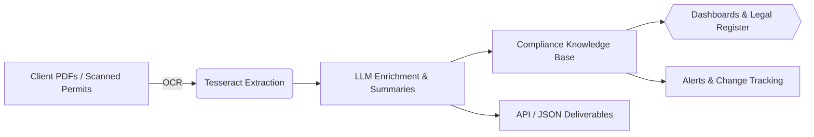

# 🌍 AI Environmental Regulation Analysis

**AI-powered toolkit for analyzing environmental regulations and compliance**

---

## 🔎 Overview

**AI Environmental Regulation Analysis** is a platform designed to streamline the review and interpretation of environmental regulatory texts.
It leverages **Large Language Models (LLMs)** and **Optical Character Recognition (OCR)** to help legal professionals, environmental consultants, and regulatory analysts **extract, summarize, and understand compliance obligations** from scanned or digital documents.

---

### Who this is for
- **Environmental consultancies** that deliver regulatory gap analyses, compliance registers, and ESG due-diligence assessments on tight deadlines.
- **Industrial operators** that must keep permits, emissions reports, and monitoring plans synchronized with evolving legislation.
- **Legal teams and compliance officers** who review large volumes of government bulletins and need decision-ready highlights rather than raw text dumps.

### Business outcomes we deliver
- **Accelerated regulatory review** — cut hours of manual reading per document to minutes with OCR + LLM assisted extraction.
- **Audit-ready documentation** — generate traceable compliance registers and summary reports that can be handed to management or authorities.
- **Cross-jurisdiction insights** — surface differences between regional or national policies so global teams can harmonize obligations.

### Typical engagement model
1. **Discovery session (1–2 hrs)** — understand your sector, document sources, and target compliance KPIs.
2. **Data onboarding** — configure secure upload or SFTP ingestion, optionally seed with historical registers and monitoring plans.
3. **Automation sprint (1–2 weeks)** — set up OCR pipelines, tune prompt templates, and align outputs with your reporting standards.
4. **Delivery & knowledge transfer** — hand over dashboards, sample datasets, deployment playbooks, and train your internal users.
5. **Ongoing support (optional)** — monthly updates to regulations, prompt improvements, and hosting/SLA options.

### Signature deliverables
- **Interactive compliance dashboard** with filters for pollutants, legal themes, jurisdictions, and document status.
- **AI-generated legal register** in PDF/Excel/JSON, including clause citations, obligations, and recommended actions.
- **Traceability package**: OCR text, structured extractions, and reasoning logs so reviewers can audit every AI output.
- **Deployment toolkit**: Docker/Nixpacks configuration, CI scripts, and environment templates for smooth handover to client infrastructure.

### Snapshot case study
> *A North African environmental consultant used the platform to process 250+ pages of EIA regulations. OCR + LLM prompts surfaced 73 actionable obligations, which were exported into a branded register and shared with the project owner within 48 hours—cutting the manual review time by 65%.*

### How the workflow fits together


### Ready to collaborate?
📩 **Book a consultation:** [hello@reg-intelligence.ai](mailto:hello@reg-intelligence.ai)  
🗓️ **Schedule a live demo:** [https://cal.com/benjawad/reg-intel-demo](https://cal.com/benjawad/reg-intel-demo)


## 🚀 Key Features

- 📝 **OCR Integration** — Converts scanned PDFs and image-based documents into searchable text using Tesseract OCR.
- 🤖 **Automated Regulatory Extraction** — Detects relevant clauses and compliance requirements using AI/LLM models.
- 📌 **Summarization & Highlighting** — Generates concise summaries of long regulations, pinpointing critical obligations.
- 🌐 **Cross-Jurisdiction Comparison** — Compares policies across regions, highlighting subtle differences.
- 🖥 **Django-Based Application** — Simple and production-ready backend for document upload and analysis.

---

## 🛠️ Tech Stack

<p align="center">
  
  
  
  
</p>

---

## 📦 Badges


---

## ⚡ Getting Started

### 1. Prerequisites
- Python 3.8+
- Tesseract OCR installed and added to your system PATH

---

### 2. Tesseract OCR Installation

#### 🖥️ Windows
1. Download Tesseract OCR from the [UB Mannheim releases](https://github.com/UB-Mannheim/tesseract/wiki).
2. During installation, **check "Add to system PATH"**.
3. (Optional) Install additional language packs you need.
4. Verify installation:
   ```bash
   tesseract --version
5. Add an environment variable if needed:
Name: TESSDATA_PREFIX
Value: C:\Program Files\Tesseract-OCR\tessdata

#### 🐧 Linux (Debian/Ubuntu)
```
sudo apt update
sudo apt install tesseract-ocr -y
sudo apt install libtesseract-dev -y
tesseract --version
```
#### 🍏 macOS (with Homebrew)
```
brew install tesseract
tesseract --version
```

### 3. Project Installation
```git clone [https://github.com/benjawad/AI-Environmental-Regulation-Analysis.git](https://github.com/benjawad/AI-Environmental-Regulation-Analysis.git)
cd AI-Environmental-Regulation-Analysis

# Create and activate a virtual environment
python -m venv venv
source venv/bin/activate  # on Windows use `venv\Scripts\activate`

# Install dependencies
pip install -r requirements.txt

# Setup database
python manage.py migrate

# Run the development server
python manage.py runserver
```
### 4. Django Configuration for OCR
In your settings.py, add the path to the Tesseract executable (Windows only):
``` TESSERACT_CMD_PATH = r'C:\Program Files\Tesseract-OCR\tesseract.exe'  ```
In your code (e.g., views.py):
```
import pytesseract
from PIL import Image
from django.conf import settings

pytesseract.pytesseract.tesseract_cmd = settings.TESSERACT_CMD_PATH
```
